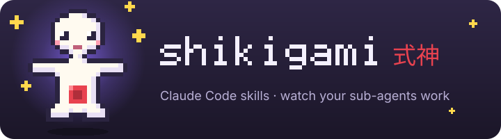
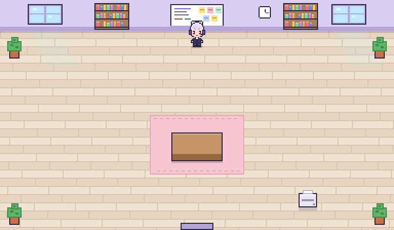

<p align="center">
  
</p>

# shikigami-skill

Claude Code skills, with **Shikigami**: a live pixel-art office where you watch your sub-agents work.

A *shikigami* (式神) is a spirit a master summons to carry out tasks, often shown as a
paper cut-out doll. Here the master is your Claude Code session, and the shikigami are its
sub-agents.

<p align="center">
  <picture>
    <source media="(prefers-reduced-motion: reduce)" srcset="assets/demo-still.png">
    
  </picture>
  <br><sub>A scripted demo run, looping. No real audit data.</sub>
</p>

## Skills

### `audit-web`

A web quality audit of a site and its source code against the 245 Opquast V5 rules, with indicative
RGAA 4.1.2 / WCAG 2.2 mappings for accessibility-related rules. It publishes an interactive report
(a Claude Artifact), re-runs during a project to track fixes, and can turn the action plan into
Jira tickets. The skill and its report are written in French.

```text
/shikigami:audit-web            first audit, or a re-run if .audit-web/audit.json exists
/shikigami:audit-web refresh    re-run and compare with the previous run
```

It is an AI assistant: it reads code and tests the live site, but does not test with assistive
technologies and certifies no conformance. A RGAA conformance rate needs a full RGAA audit checked
by a human auditor.

## Shikigami: the live agent view

When the audit splits its work across sub-agents, Shikigami shows them as characters in a top-down
pixel office: who is working on what, trips to the bookshelf, the windows or the printer, progress
per agent, errors, and the results each one hands back to the whiteboard. A lead character,
Kantoku, coordinates and merges the copies.

- **Free to run:** it reads the transcripts Claude Code already writes to disk. No hooks, no tokens.
- **Interactive:** click a character for its detail panel; keyboard and screen-reader friendly.
- **Replays:** export any run as one self-contained HTML file with play, pause, speed and timeline.

```bash
node skills/audit-web/viewer/server.mjs                     # live, from the audited repo
node skills/audit-web/viewer/server.mjs --replay --speed 10  # replay the last run
node skills/audit-web/viewer/export-replay.mjs --out replay.html
```

See [`viewer/README.md`](skills/audit-web/viewer/README.md) for the event contract and
how to edit the characters.

| Character    | Meaning                    | Looks after                 |
| ------------ | -------------------------- | --------------------------- |
| Kantoku      | 監督, direction            | coordination (main session) |
| Fumi Kaku    | 文 writing, 書く to write  | content and forms           |
| Tsuna Hikari | 綱 link, 光 light          | links and media             |
| Michi Iro    | 道 path, 色 color          | navigation and presentation |
| Mamo Kumo    | 守る to protect, 雲 cloud  | security and server         |

## Install

Requirements: Claude Code, Node ≥ 20, Python 3.

As a plugin, from this repository's marketplace:

```bash
claude plugin marketplace add npier97/shikigami-skill
claude plugin install shikigami@shikigami
```

Or, in Claude Code 2.1.275 or later: `/plugin install shikigami --marketplace npier97/shikigami-skill`.

As a personal skill:

```bash
cp -R skills/audit-web ~/.claude/skills/
```

Installed this way it runs as `/audit-web`, without the `shikigami:` prefix.

The repository is both a Claude Code plugin (`.claude-plugin/plugin.json`, `skills/`) and its own
marketplace (`.claude-plugin/marketplace.json`).

## Logo

`assets/logo.svg` (square icon), `assets/banner.svg` and `assets/social.svg` (GitHub social
preview, 1280 × 640) are drawn from pixel grids by `assets/make_logo.py`: edit the grid there
and run `python3 assets/make_logo.py assets`. `assets/social-preview.png` is `social.svg`
rendered with headless Chrome, for the repository's social preview setting.

## License

[MIT](LICENSE), © 2026 npier97, except `references/rules-v5.json`, which stays under the
Opquast rules' CC BY-SA licence ([details](skills/audit-web/references/LICENSE-rules.md)).

## Credits

- Opquast rules: [Opquast](https://checklists.opquast.com/), Creative Commons BY-SA. The catalog in
  `references/rules-v5.json` holds short rewordings, not the official rule titles, and stays under
  the same licence.
- RGAA 4.1.2 and WCAG 2.2 references are indicative mappings, not conformance verdicts.
